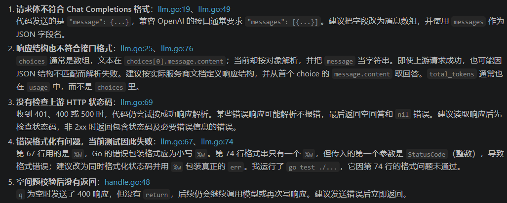

## 使用前注意事项

如果想调用`GET /ask?q=`的话要先设置`AI_API_KEY`:

```
$env:AI_API_KEY="......"
```


## 关于过程中的问题及解决方法

​	`task 9`中大部分文件都是跟着`task 9文档`跟着走的，中间会通过AI询问各个函数及中间件的用法。测试的文件有两个，`llm_test.go`是由AI一键生成的，`go_test.go`是在AI辅助下完成的。`/ask`接口是自己参照着`task 5`自己做的，中途也有问过AI(如Handler结构体下持有哪个结构体来进行下一步)，但是敲完代码后发现有问题（`anser`返回一直未空），AI给出问题诊断在下面，主要问题：1.状态码不对，没对大模型返回的状态码进行诊断；2.请求体的格式不符合兼容Open AI的标准（这里原本想着只是一次对话就给数组改了）；3.一些细节问题。



